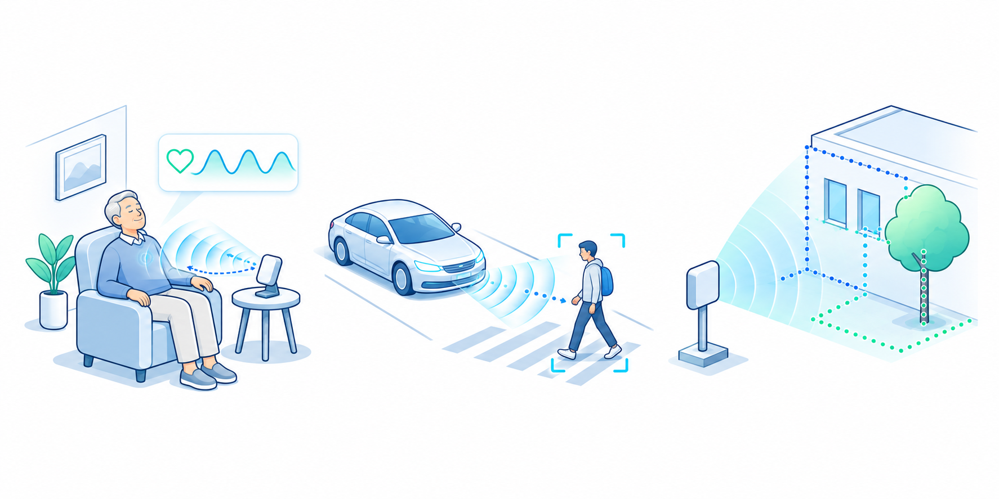

::: {style="float: right; margin-right: 10px;"}
{width="400px"}
:::
Wireless sensing offers new ways to understand people, objects, and activities in everyday environments. We investigate how Wi-Fi, radar, and backscatter technologies can capture human motion, physiological activity, and spatial information to support applications in health monitoring, transportation, and environmental perception. Our research combines complementary sensing modalities and develops methods that remain reliable under movement, occlusion, interference, and changing surroundings. We also study how to protect wireless sensing systems against spoofing and manipulation. Through system prototyping and experimental evaluation, we aim to translate advances in wireless technology into practical tools for continuous health monitoring, safer autonomous systems, and more responsive living environments.

## Related Publications
::: {#publications}
:::