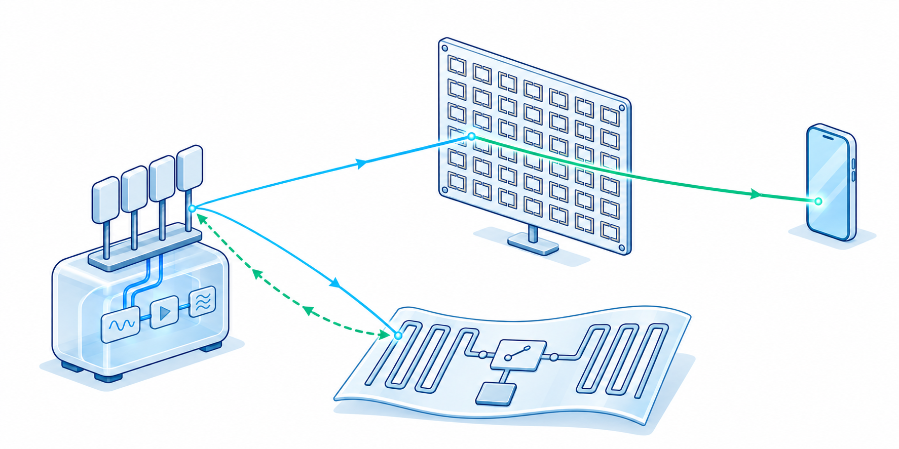

::: {style="float: right; margin-right: 10px;"}
{width="400px"}
:::
The capabilities of wireless systems depend on both how signals are processed and how they interact with surroundings. We design wireless hardware and systems that create new opportunities for energy-efficient sensing and communication. Our research spans backscatter devices that communicate by modulating reflected signals, passive and reconfigurable surfaces that shape radio propagation, and platforms that integrate sensing and communication. By jointly designing hardware, signal processing, and control algorithms, we seek to expand wireless coverage, improve sensing performance, and reduce deployment and maintenance costs. These efforts provide building blocks for low-power IoT devices, unobtrusive wearable sensors, and adaptable wireless infrastructure.

## Related Publications
::: {#publications}
:::